
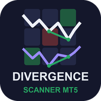

# Divergence Scanner (MetaTrader 5 and MetaTrader 4)

A scanner indicator that shows the latest **RSI, MACD, Stochastic, CCI and OBV divergence** of many symbols and timeframes
in one panel on your chart, how long ago it was confirmed and how many oscillators agree, and sends an alert when a new
one appears.

> **This is a showcase repository: documentation and images only. There is no source code here.** The product is sold on
> the MQL5 Market. The free single-chart indicator it builds on has public source:
> [allanninal/divergence-signal-alerts](https://github.com/allanninal/divergence-signal-alerts).

**Website:** [allanninal.dev/mql5 (indicators)](https://www.allanninal.dev/mql5/#indicators) · [MT4 editions](https://www.allanninal.dev/mql5/#mt4) · [allanninal.dev](https://www.allanninal.dev)
· **Contact:** message me on [LinkedIn](https://www.linkedin.com/in/allanninal/).

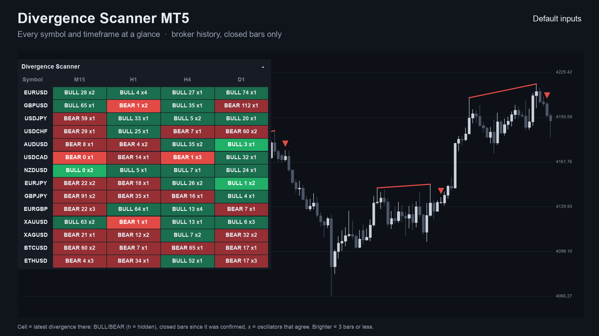

## Get it on the MQL5 Market

| Product | Platform | Price | Link |
|---|---|---|---|
| **Divergence Scanner MT5** | MT5 | paid | <https://www.mql5.com/en/market/product/201796> |
| **Divergence Scanner MT4** | MT4 | paid | <https://www.mql5.com/en/market/product/202403> |
| Divergence Signal Alerts (single chart, source on GitHub) | MT5 | free | <https://www.mql5.com/en/market/product/201785> |
| Divergence Signal Alerts MT4 (single chart, source on GitHub) | MT4 | free | <https://www.mql5.com/en/market/product/202356> |

The scanner is standalone: you do not need to install the free indicator to use it. Details, current price and the
Strategy Tester demo are on the Market pages.

## What it does

- A panel on the chart with **symbols as rows and timeframes as columns**. By default it lists the symbols in your Market
  Watch against M15, H1, H4 and D1; you can use your own lists instead.
- **In each cell:** `BULL` or `BEAR` (`h` marks a hidden divergence), the closed bars since it was confirmed, and `x1`, `x2`,
  `x3` ... for how many oscillators agree, for example `BULL 3 x3`.
- **Five oscillators**, each of which can be switched off: RSI, MACD, Stochastic, CCI and OBV (tick volume).
- You choose how many oscillators must agree before a cell shows a divergence, and how many before an alert is sent.
- A **brighter cell** when the divergence is recent (you choose how many bars count as fresh).
- **Click a cell** to open that symbol and timeframe.
- **Alerts:** pop-up (on by default), sound, push notification and e-mail, each switched separately. Nothing is sent while
  history loads, never twice for the same cell and bar, and not in the Strategy Tester. Cells that confirm together are
  sent as one message.
- **Closed bars only.** A cell does not change after its bar has closed. It places no orders.
- Works on any symbol with history, including gold and crypto.

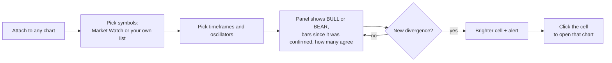

### The grid at a glance

Each cell is one symbol on one timeframe. You read the market across the whole list in a single look instead of flipping
through charts.

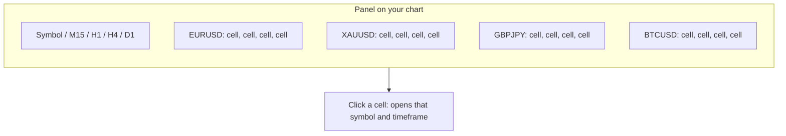

### What a cell can show

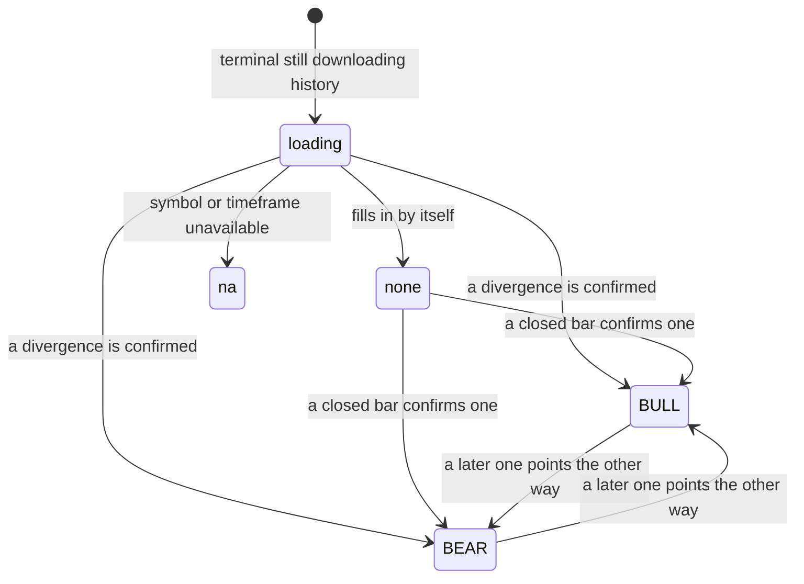

| | |
|---|---|
| 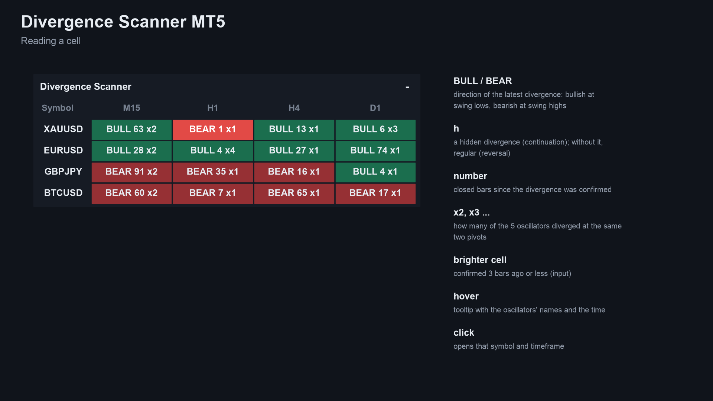 | 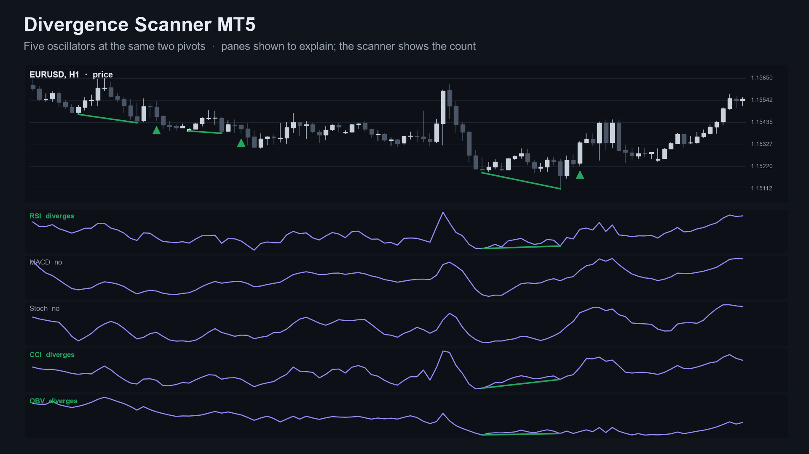 |
| 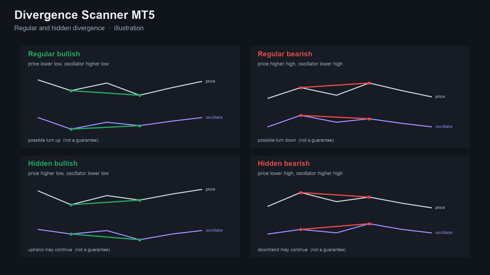 | 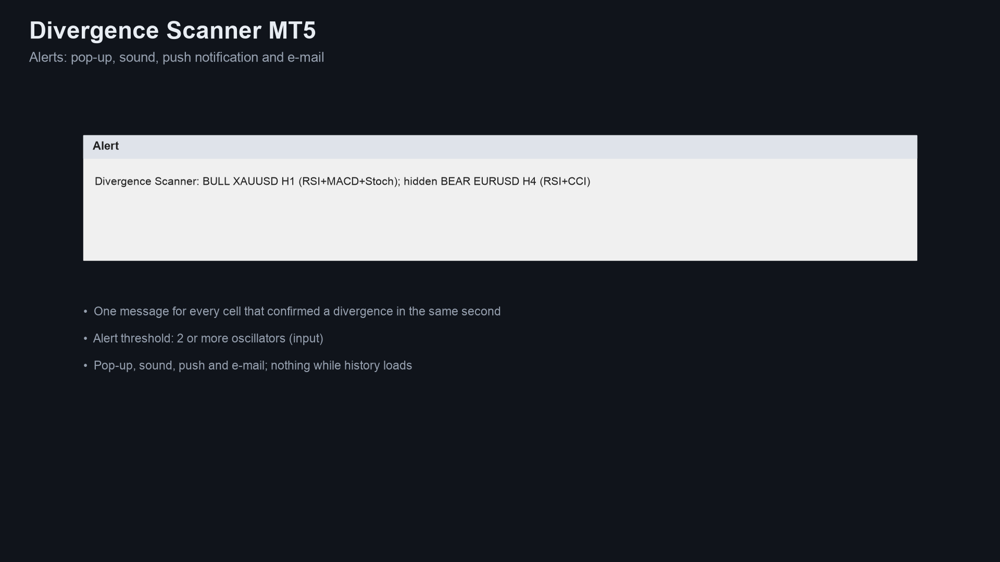 |

MT4 edition screenshots: [panel on a chart](images/mt4/01-scanner-on-chart.png), [reading a cell](images/mt4/02-reading-a-cell.png).
Some screenshots are illustrations built from broker history, not terminal captures.

## Who it is for

Traders who use divergence on several symbols or timeframes. If you watch one chart with RSI and MACD, the free
[Divergence Signal Alerts](https://www.mql5.com/en/market/product/201785) is enough.

## Why it was built

- Divergence is one of the most-requested classic methods in our October 2026 market research: hundreds of divergence
  indicators exist on the MQL5 Market and the most popular single-oscillator ones sell at about 30 USD, but multi-symbol
  scanners were a thinner tier.
- The same research found that the named method is requested only rarely on freelance boards, so this is a convenience
  product for people who already use divergence, not a claim of mass demand.
- Design rule carried over from the free indicator: trust. Cells use closed bars only, so what you saw does not change.

## How often it signals

Starting-settings table from the listing: how often a cell gets a new divergence, per symbol per month, on EURUSD, GBPUSD,
USDJPY and XAUUSD, October 2023 to October 2026, closed bars, default settings. A code count, not a trading result.

| Timeframe | Any oscillator | 2 or more agree | 3 or more agree |
|---|---|---|---|
| M15 | about 61 to 67 | about 25 to 28 | about 9 to 12 |
| H1 | about 14 to 16 | about 6 to 7 | about 2 to 3 |
| H4 | about 3 to 4 | about 1.4 to 1.8 | about 0.4 to 0.7 |
| D1 | about 0.4 to 0.6 | up to 0.4 | fewer than 0.2 |

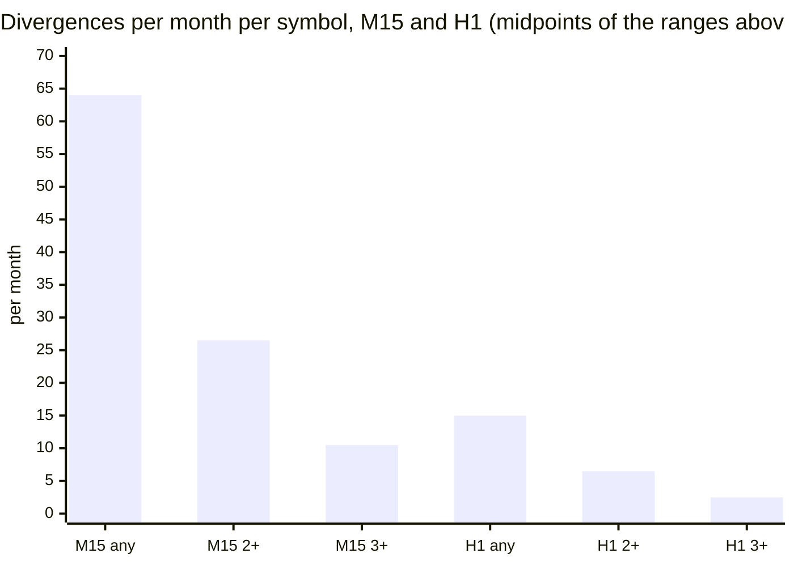

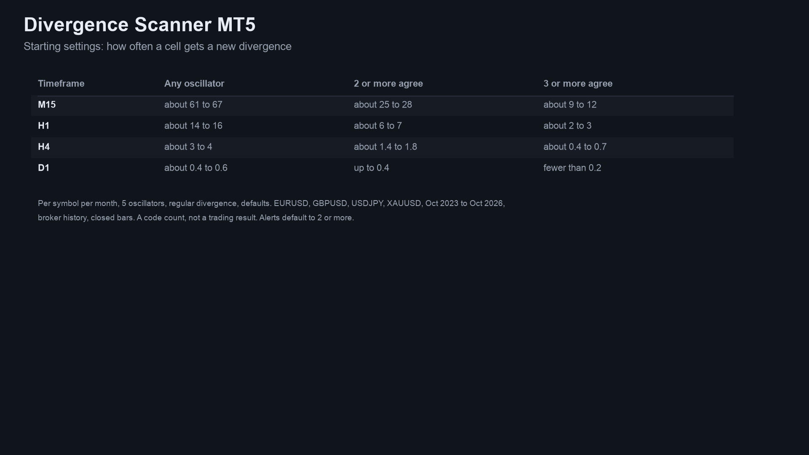

## How it was checked (results)

Every cell value was compared with an independent Python calculation. Results of the MT4 edition's final run (MetaTrader 4
Strategy Tester, 4 symbols, M15 and the higher timeframes the cells read):

| Check | Result |
|---|---|
| Test files compared | 156, all pass |
| Values compared | 25,669,360, 0 differences |
| Panel counts vs the test's own cells, every tick | 8,802,927 ticks, 0 mismatches |
| Excluded | the start-up ticks of each run (188,583 in total), before every cell has its full window |
| Cells using the forming bar | none; live runs used closed bars only |

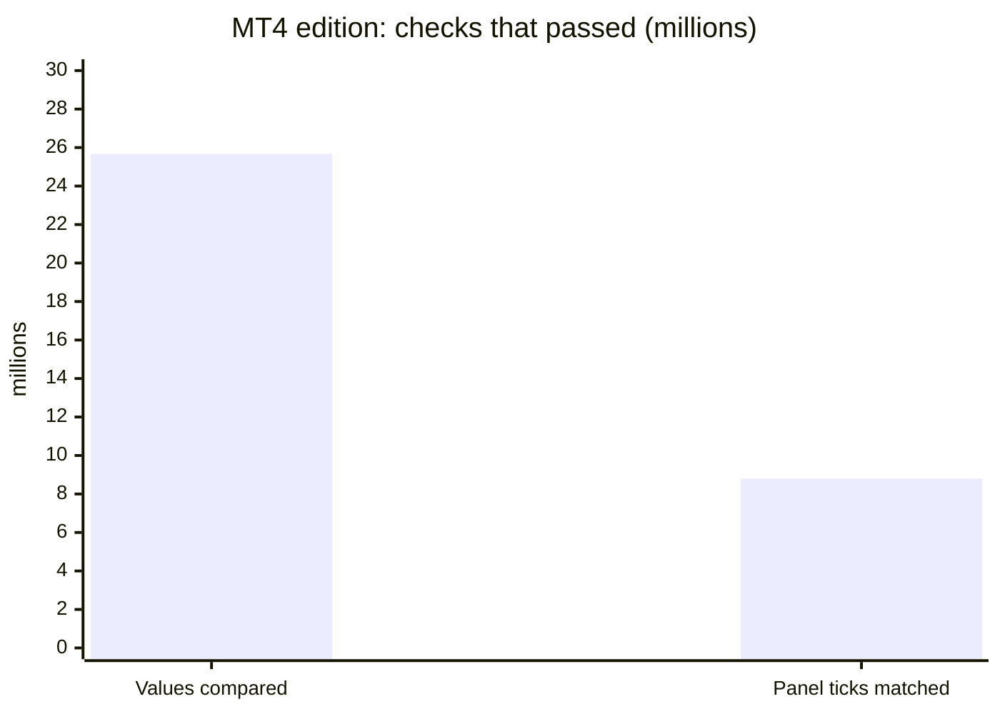

The MT5 edition runs the same calculation. Its checks: the divergence engine matched the Python reference bar by bar on
48 of 48 test files (engine and loader), and passed a repaint test (XAUUSD H1, 91,052,717 ticks, 0 changed signals). These
are code checks, not trading results.

## Honest limits

- A scanner shows the state of a technical rule. It does not predict the market, and past signals are no indication of
  future results. No profit or accuracy claim is made. Agreement between oscillators is not a promise of a turn.
- A divergence is only known a few closed bars after the pivot formed, so a cell is always late by design.
- OBV uses tick volume, which differs between brokers.
- It is an indicator: it places no orders and manages no risk.
- It needs the terminal running to alert, and push needs your MetaQuotes ID set up in the terminal.
- The source is not published; this repository documents what the product does and the results of its checks.

## Free vs paid

| | Divergence Signal Alerts (free) | Divergence Scanner (paid) |
|---|---|---|
| Scope | one chart | many symbols x timeframes in one panel |
| Oscillators | RSI, MACD | RSI, MACD, Stochastic, CCI, OBV, with a count of how many agree |
| Output | arrows and lines on the chart | BULL / BEAR cells with bars since confirmation |
| Alerts | pop-up, sound, push, e-mail | pop-up, sound, push, e-mail |
| MT5 | [201785](https://www.mql5.com/en/market/product/201785) | [201796](https://www.mql5.com/en/market/product/201796) |
| MT4 | [202356](https://www.mql5.com/en/market/product/202356) | [202403](https://www.mql5.com/en/market/product/202403) |
| Source | [public on GitHub](https://github.com/allanninal/divergence-signal-alerts) | not published |

---

**Website:** [allanninal.dev/mql5](https://www.allanninal.dev/mql5/#indicators) · [MT4](https://www.allanninal.dev/mql5/#mt4) · [allanninal.dev](https://www.allanninal.dev)
· Questions: message me on [LinkedIn](https://www.linkedin.com/in/allanninal/). All rights reserved, see [LICENSE](LICENSE).
